[Español](README.md) · **English**

# Mi Kinder: school management system (Colegio CAPI)


A web app for running the day-to-day of a kindergarten. The principal and teachers sign in
with a username and password and from there they manage classes, students, attendance and
assessments. The main feature is generating PDF report cards.

The whole interface is web pages that open in the browser, and the data lives in a local
database on the machine. That means it runs offline, with no external services to depend on.

## Screenshots

| Sign in | Dashboard |
| --- | --- |
| 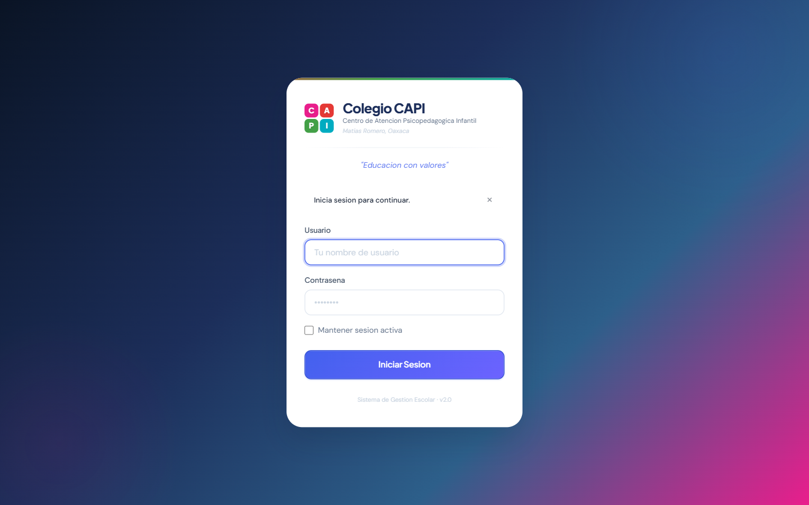 | 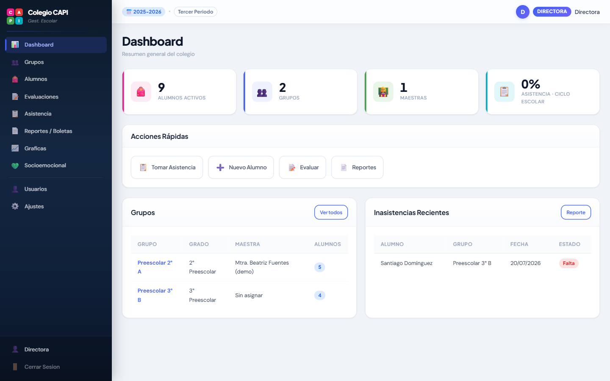 |

| Students | Report card |
| --- | --- |
| 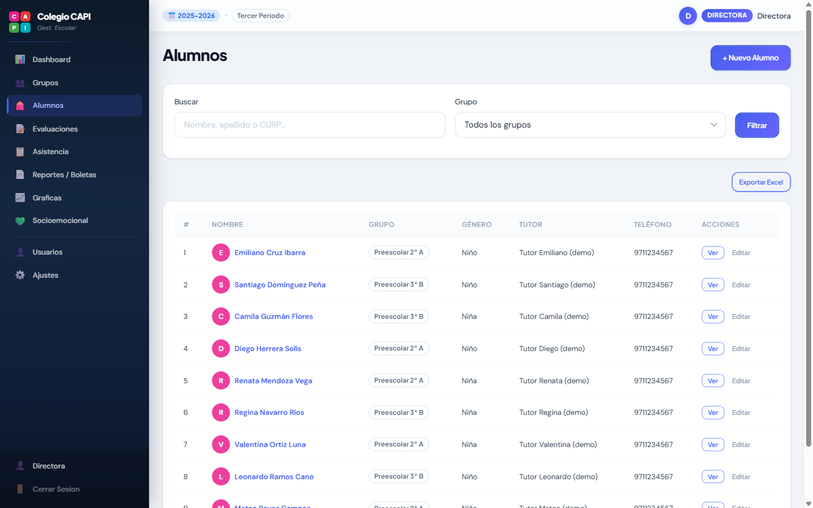 | 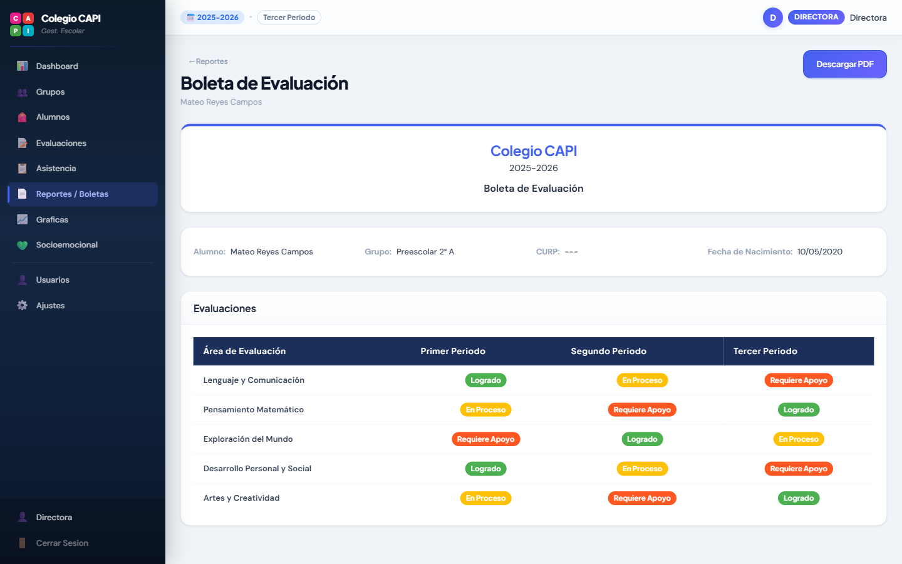 |

| Assessments | Users and roles |
| --- | --- |
| 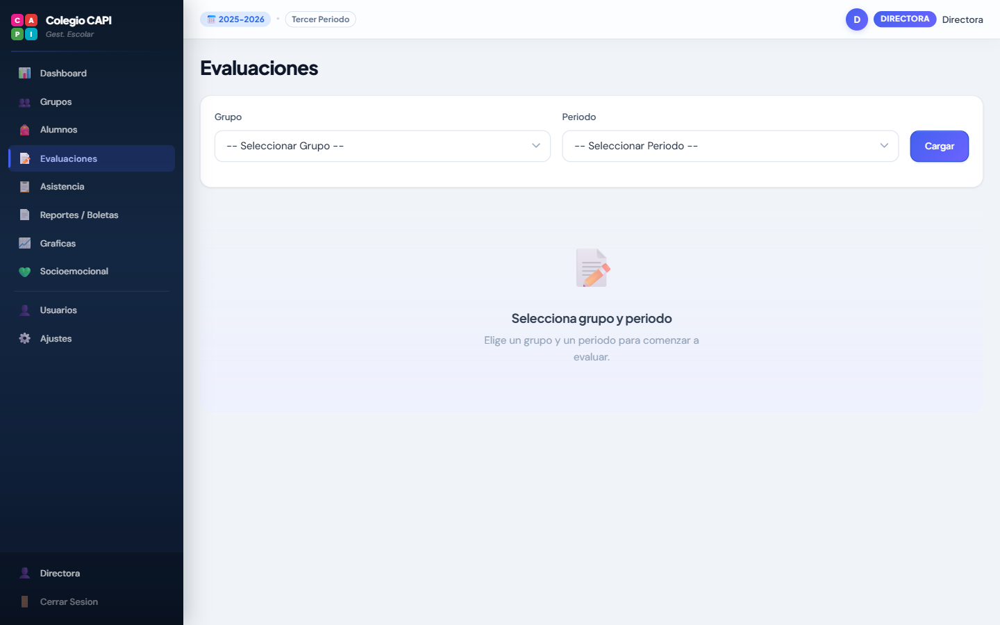 | 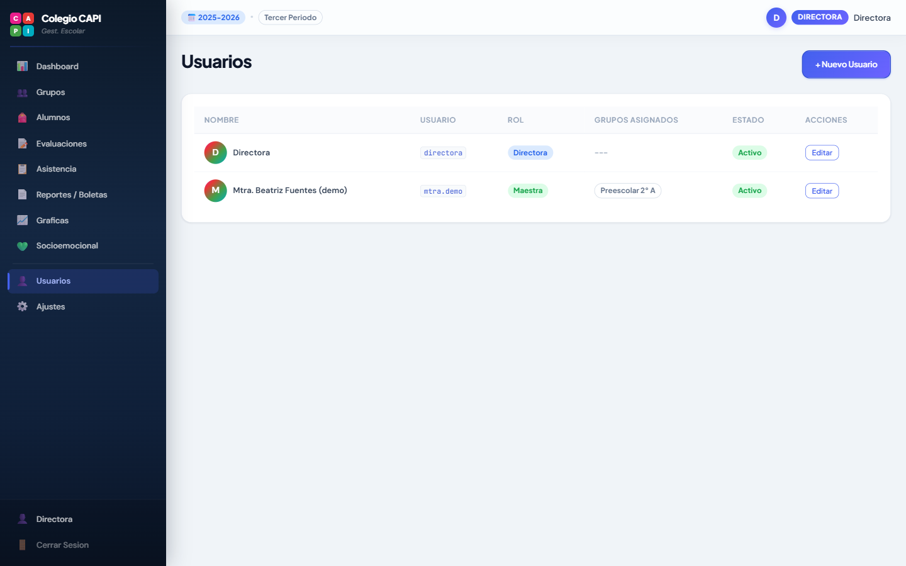 |

| Reports / Report cards | Charts |
| --- | --- |
| 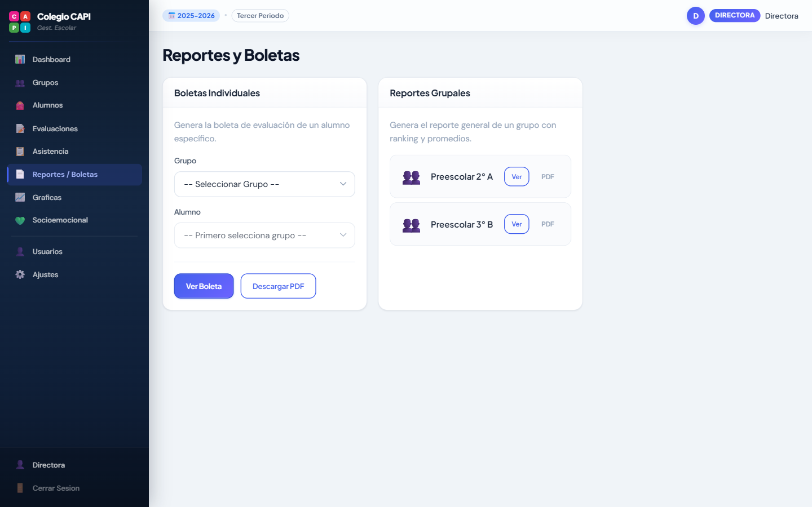 | 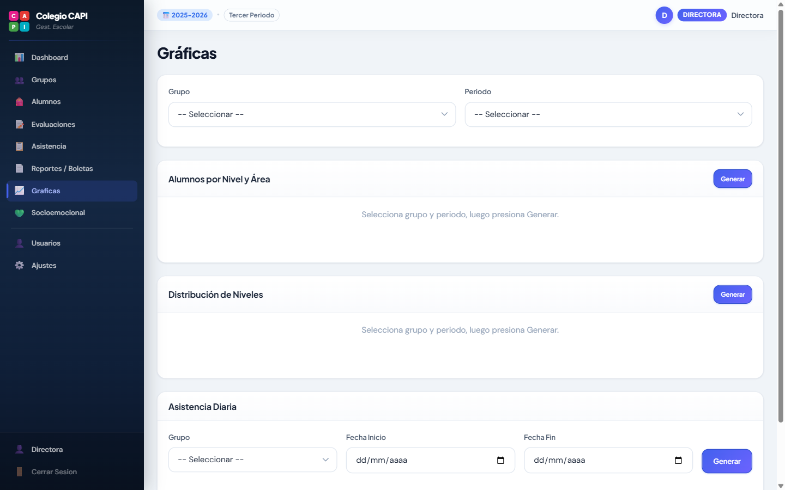 |

| Class report (ranking) | Report card exported to PDF |
| --- | --- |
| 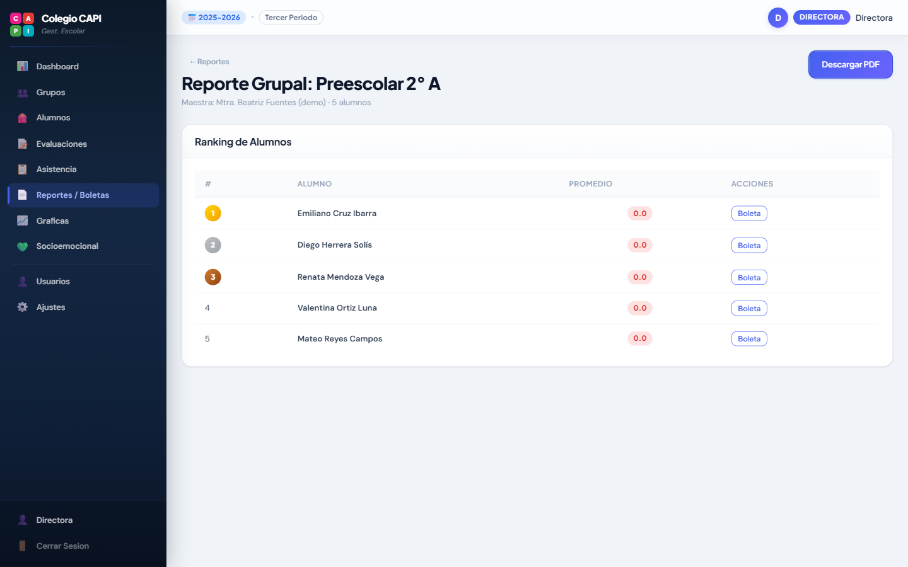 | 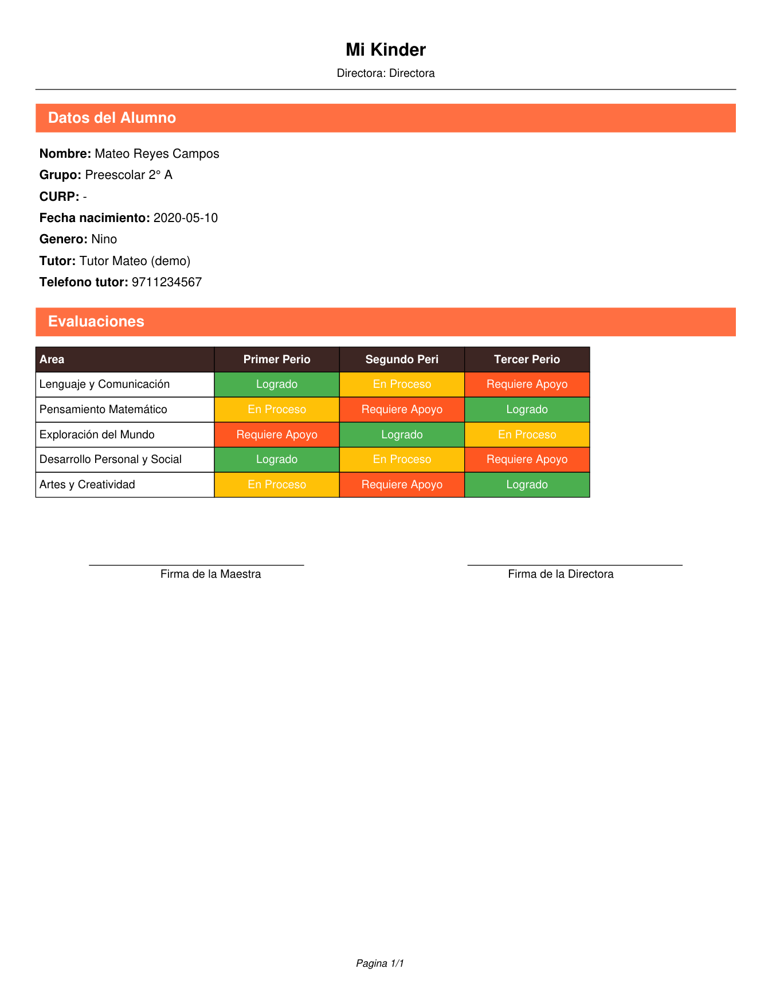 |

The last image is the actual PDF downloaded from the system, with the teacher's and
principal's signatures. The screenshots use fictional demo data; the real system never
exposes student information in this repository (the database lives outside the project, see
Privacy).

## Roles and permissions

| Capability | Principal | Teacher |
| --- | :---: | :---: |
| School-wide dashboard | Yes | Own class only |
| See all classes and students | Yes | Assigned classes only |
| Add/edit students | Yes | Yes |
| Take attendance | Yes | Yes |
| Enter assessments | Yes | Yes |
| Generate report cards and reports | Yes | Yes |
| User management (create teachers) | Yes | No |
| School and school-year settings | Yes | No |

## Features

- Role-based authentication (principal / teacher) with passwords hashed using bcrypt and
  server-side sessions. A teacher only sees the classes assigned to her.
- School years and terms: each year (e.g. 2025-2026) has its three terms, and the system
  always works on the active year and term.
- In classes and students you enroll the student with their details and the guardian's,
  a photo and grade level, and you can transfer students between classes keeping the history.
- Daily attendance per class (present / absent / late / excused).
- Assessment by area (Language, Mathematical Thinking, etc.) on a configurable achievement
  scale (Achieved / In Progress / Needs Support), per student and term.

The core of the app is report cards and reports:

- Individual report card with the school header, the student's details and an areas by terms
  matrix showing the achievement level. It renders on screen and downloads as a PDF
  (generated with fpdf2).
- Class report with class averages and ranking, also exportable to PDF.
- Student list export to Excel (openpyxl).

There are also performance charts by level/area and attendance charts (matplotlib),
social-emotional tracking with per-student notes, user management (principal only) and
school settings.

## Architecture

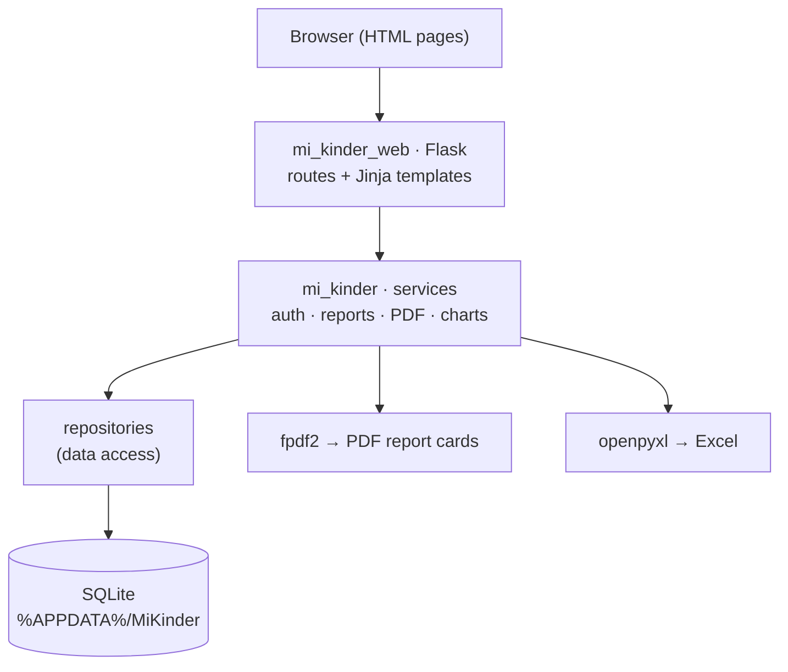

It is split into layers: web (Flask + templates) calls the services (authentication,
reports, PDF and chart generation), those use the repositories (queries), and everything
lands in the SQLite database, whose schema is versioned with migrations.

## Project structure

```
run_web.py              # starts the server (http://localhost:5000)
mi_kinder/              # domain core
  ├── database/         # schema, migrations, seed, connection
  ├── models/           # entities (student, class, assessment, school year…)
  ├── repositories/     # data access
  └── services/         # auth, reports, PDF, charts, session
mi_kinder_web/          # web layer
  ├── app.py            # Flask app factory
  ├── routes/           # login, dashboard, classes, students, assessments,
  │                     #   attendance, reports, charts, users, settings…
  ├── templates/        # HTML pages (Jinja)
  └── static/           # CSS and JS
docs/                   # screenshots for this README
```

## Setup and usage

```bash
pip install -r requirements-web.txt
python run_web.py
# Open http://localhost:5000
```

On first run the system creates the database and a default principal account so you can
sign in:

```
Username:  directora
Password:  admin123
```

It is a good idea to change that password from Users before any real use. The database,
photos and backups are stored in `%APPDATA%/MiKinder/`, outside this project.

## Privacy

This repository contains only the code. The database with student information lives outside
the project (`%APPDATA%/MiKinder/`) and is excluded via `.gitignore`, so it is never
committed. The screenshots in this README use fictional demo data.

## Stack

Python · Flask 3 · SQLite (sqlite3) · bcrypt · fpdf2 (PDF) · openpyxl (Excel) ·
matplotlib (charts) · Pillow · Jinja2 · HTML/CSS/JS.

## License

The code is released under the [MIT](LICENSE) license. "Colegio CAPI" is just the project
context, and the screenshots use fictional demo data (see Privacy).

---
Ángel Josué García Canteros · [github.com/angeljgc-dev](https://github.com/angeljgc-dev)
