[English](README.en.md) · **Español**

# Mi Kinder: sistema de gestión escolar (Colegio CAPI)


Aplicación web para la gestión escolar de un jardín de niños. La directora y las maestras
entran con su usuario y contraseña y desde ahí administran grupos, alumnos, asistencia y
evaluaciones. La función central es la generación de boletas de evaluación en PDF.

Toda la interfaz son páginas web que se abren en el navegador y los datos viven en una base
local del equipo, así que funciona sin internet y sin depender de servicios externos.

## Capturas

| Inicio de sesión | Panel principal |
| --- | --- |
| 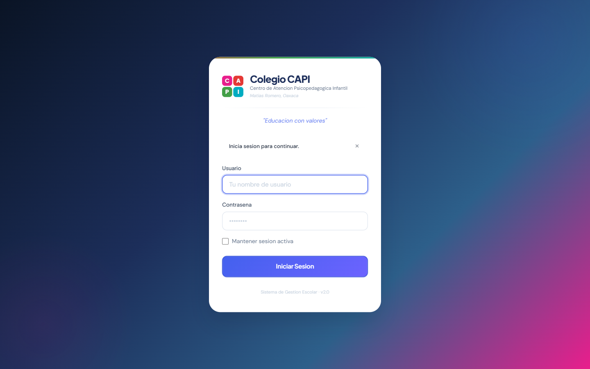 | 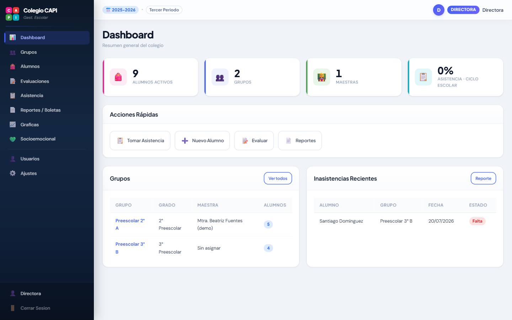 |

| Alumnos | Boleta de evaluación |
| --- | --- |
| 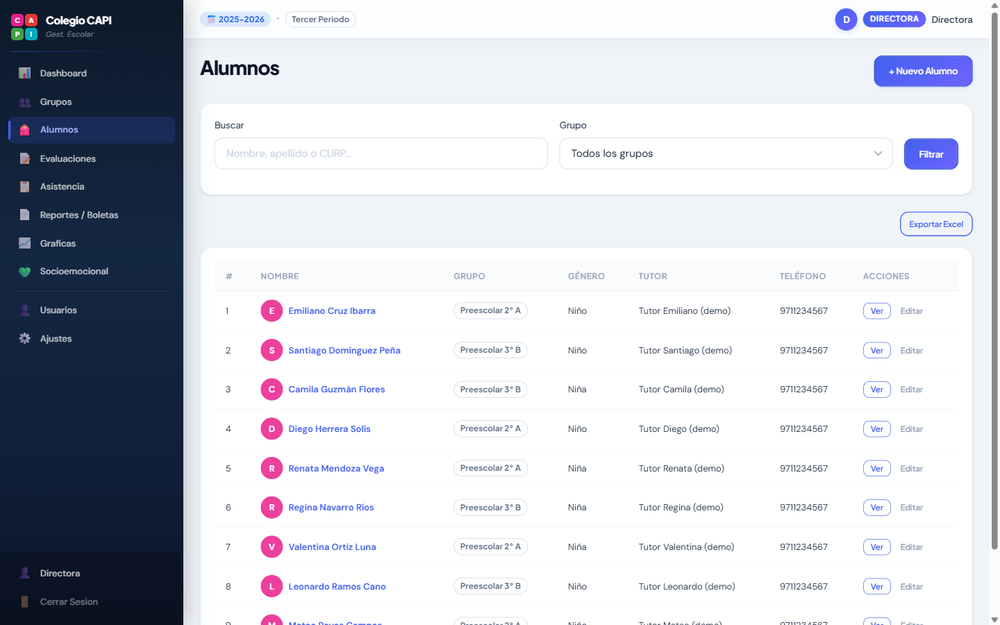 | 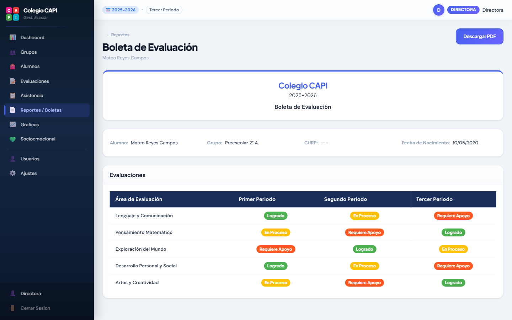 |

| Evaluaciones | Usuarios y roles |
| --- | --- |
| 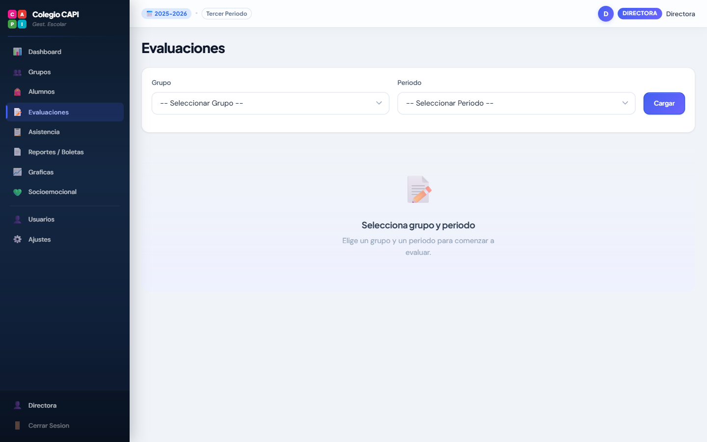 | 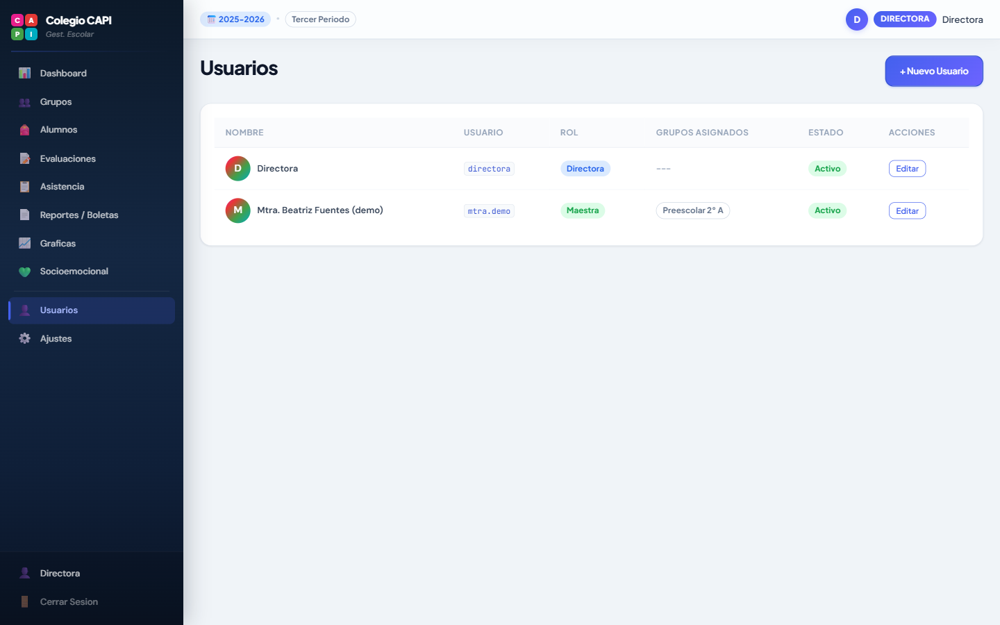 |

| Reportes / Boletas | Gráficas |
| --- | --- |
| 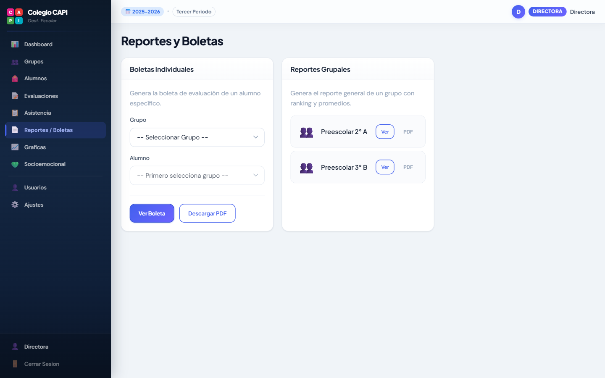 | 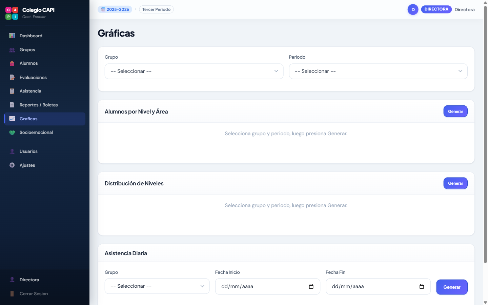 |

| Reporte grupal (ranking) | Boleta generada en PDF |
| --- | --- |
| 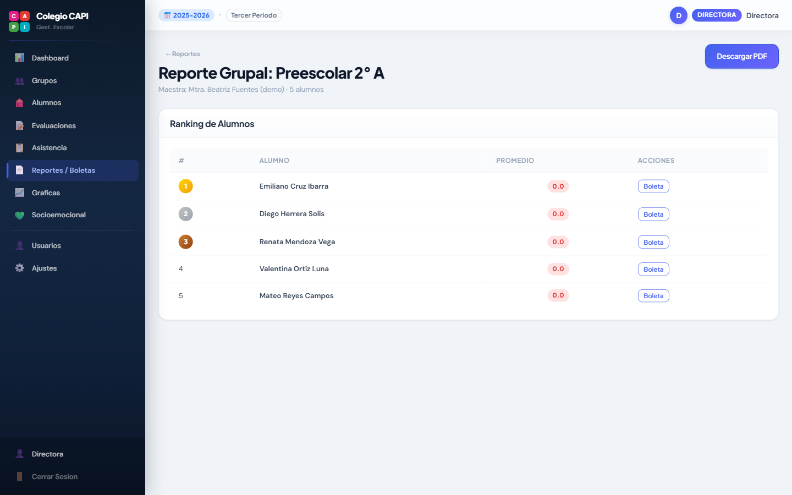 | 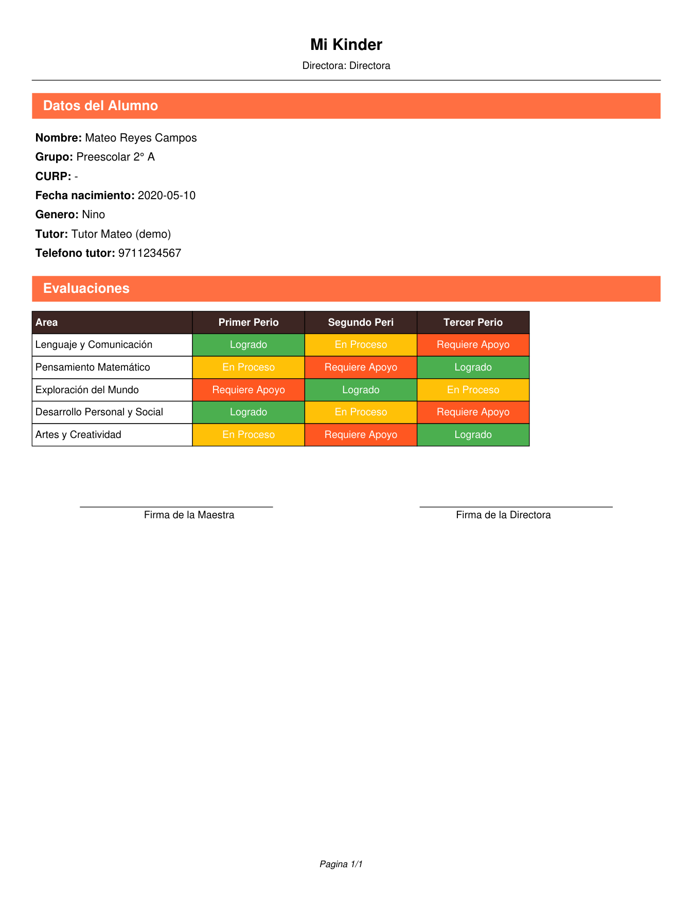 |

La última imagen es el PDF real descargado desde el sistema, con las firmas de maestra y
directora. Las capturas se tomaron con datos ficticios de demostración; el sistema real
nunca expone información de alumnos en este repositorio (la base de datos vive fuera del
proyecto, ver Privacidad).

## Roles y permisos

| Capacidad | Directora | Maestra |
| --- | :---: | :---: |
| Panel general del colegio | Sí | Solo su grupo |
| Ver todos los grupos y alumnos | Sí | Solo grupos asignados |
| Alta/edición de alumnos | Sí | Sí |
| Tomar asistencia | Sí | Sí |
| Capturar evaluaciones | Sí | Sí |
| Generar boletas y reportes | Sí | Sí |
| Gestión de usuarios (crear maestras) | Sí | No |
| Ajustes del colegio y ciclo escolar | Sí | No |

## Funcionalidad

- Autenticación por roles (directora / maestra) con contraseñas cifradas con bcrypt y
  sesiones de servidor. Una maestra solo ve los grupos que le fueron asignados.
- Ciclos escolares y periodos: cada ciclo (por ejemplo 2025-2026) con sus tres periodos, y
  el sistema trabaja siempre sobre el ciclo y periodo activos.
- En grupos y alumnos se da de alta al alumno con sus datos y los del tutor, foto y grado, y
  se pueden traspasar alumnos entre grupos guardando el historial.
- Asistencia diaria por grupo (presente / ausente / retardo / justificada).
- Evaluación por áreas (Lenguaje, Pensamiento Matemático, etc.) con una escala de logro
  configurable (Logrado / En Proceso / Requiere Apoyo), por alumno y periodo.

La parte central son las boletas y reportes:

- Boleta individual con el encabezado del colegio, los datos del alumno y una matriz de
  áreas por periodos con el nivel de logro. Se ve en pantalla y se descarga en PDF (generado
  con fpdf2).
- Reporte grupal con promedios y ranking del grupo, también exportable a PDF.
- Exportación de listas de alumnos a Excel (openpyxl).

También hay gráficas de desempeño por nivel/área y de asistencia (matplotlib), seguimiento
socioemocional con observaciones por alumno, gestión de usuarios (solo directora) y ajustes
del colegio.

## Arquitectura

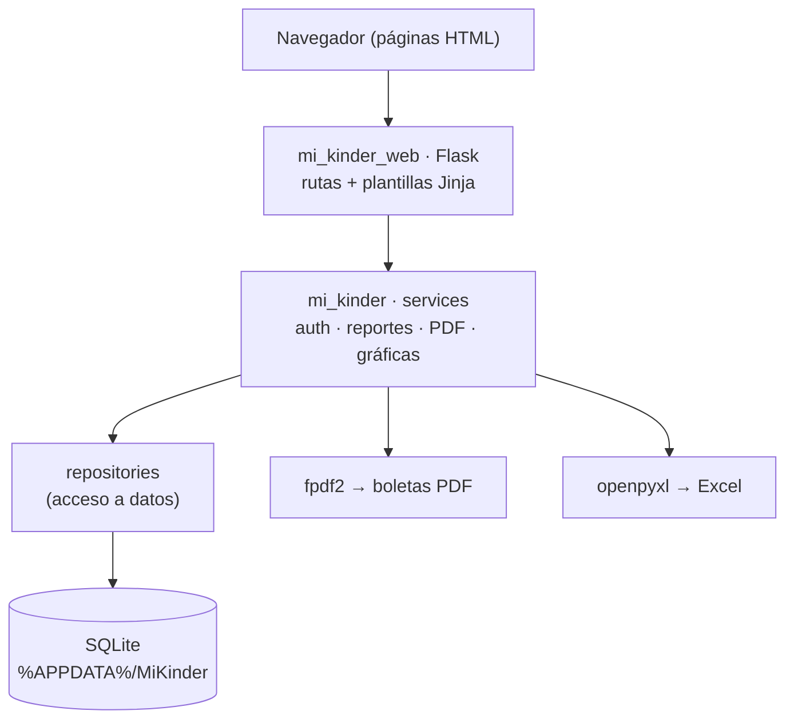

Está separado por capas: web (Flask + plantillas) llama a los servicios (autenticación,
reportes, generación de PDF y gráficas), estos usan los repositorios (consultas) y todo cae
en la base de datos SQLite, cuyo esquema se versiona con migraciones.

## Estructura

```
run_web.py              # arranca el servidor (http://localhost:5000)
mi_kinder/              # núcleo de dominio
  ├── database/         # esquema, migraciones, seed, conexión
  ├── models/           # entidades (alumno, grupo, evaluación, ciclo…)
  ├── repositories/     # acceso a datos
  └── services/         # auth, reportes, PDF, gráficas, sesión
mi_kinder_web/          # capa web
  ├── app.py            # creación de la app Flask
  ├── routes/           # login, dashboard, grupos, alumnos, evaluaciones,
  │                     #   asistencia, reportes, gráficas, usuarios, ajustes…
  ├── templates/        # páginas HTML (Jinja)
  └── static/           # CSS y JS
docs/                   # capturas para este README
```

## Instalación y uso

```bash
pip install -r requirements-web.txt
python run_web.py
# Abre http://localhost:5000
```

Al primer arranque el sistema crea la base de datos y una cuenta de directora por defecto
para poder entrar:

```
Usuario:     directora
Contraseña:  admin123
```

Conviene cambiar esa contraseña desde Usuarios antes de usarlo de verdad. La base de datos,
las fotos y los respaldos se guardan en `%APPDATA%/MiKinder/`, fuera de este proyecto.

## Privacidad

Este repositorio contiene solo el código. La base de datos con información de alumnos vive
fuera del proyecto (`%APPDATA%/MiKinder/`) y está excluida por `.gitignore`, así que nunca
se sube al repositorio. Las capturas de este README usan datos ficticios de demostración.

## Stack

Python · Flask 3 · SQLite (sqlite3) · bcrypt · fpdf2 (PDF) · openpyxl (Excel) ·
matplotlib (gráficas) · Pillow · Jinja2 · HTML/CSS/JS.

## Licencia

El código se publica bajo licencia [MIT](LICENSE). "Colegio CAPI" es solo el contexto del
proyecto y las capturas usan datos ficticios de demostración (ver Privacidad).

---
Ángel Josué García Canteros · [github.com/angeljgc-dev](https://github.com/angeljgc-dev)
